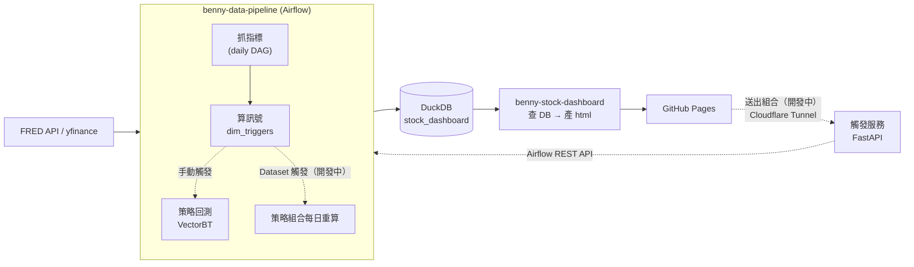

# benny-stock-dashboard

全球大總經與市場情緒轉折監測系統的**產出端**：兩份靜態 dashboard html，由
GitHub Pages 託管。抓資料、算指標、判斷訊號、跑策略回測都不在這個 repo
發生——那些邏輯在 `benny-data-pipeline` 的 Airflow DAG 裡跑，寫進
`benny-data-infra` 管理的共用 DuckDB（schema: `stock_dashboard`）。這個
repo 只做一件事：**查 DuckDB → 產靜態 html → push**。

整個系統圍繞四個概念運作：

| 概念 | 是什麼 | 存在哪 |
|---|---|---|
| **指標**（Indicator） | 8 大美股/總經數據 + 台股大盤/台積電，另外算 3 個跨指標比值 | `raw_stock`/`silver_stock` |
| **訊號**（Signal / Trigger） | 指標觸發某個量化條件的事件（金叉死叉、恐慌、倒掛...） | `dim_triggers` |
| **策略**（Strategy） | 拿訊號當進出場依據，用 VectorBT 回測績效；寫死策略 + 使用者自組的策略組合（開發中） | `backtest_*`（寫死策略 4 張表）、`backtest_strategy_defs`/`backtest_strategy_results`（策略組合） |
| **儀表板**（Dashboard） | 把上面三個查出來畫成圖，這個 repo 負責 | `output/*.html` |

## 指標（Indicator）

真實指標直接從 FRED/yfinance 抓，合成指標是跨指標比值、現算不打 API。
定義集中在 `benny-data-pipeline` 的 `constants/index_map.py`（唯一事實
來源），白話說明另外寫死一份在 `scripts/build_dashboard.py` 的
`GLOSSARY` dict（決定 12-C：不跨 repo import，`index_name` 已經
denormalize 進每一列）。

| id | 指標 | market | 來源 |
|---|---|---|---|
| 1 | 10年期美債殖利率（DGS10） | us | FRED |
| 2 | 2年期美債殖利率（DGS2） | us | FRED |
| 3 | 10Y-2Y 殖利率利差（T10Y2Y） | us | FRED |
| 4 | VIX 恐慌指數 | us | yfinance |
| 5 | S&P 500 指數 | us | yfinance |
| 6 | Nasdaq 指數 | us | yfinance |
| 7 | 費城半導體指數（SOX） | us | yfinance |
| 8 | 道瓊工業指數（DJI） | us | yfinance |
| 9 | 羅素 2000 指數（RUT） | us | yfinance |
| 10 | 台股加權指數 | tw | yfinance |
| 11 | 台積電（2330.TW） | tw | yfinance |
| 101 | SOX/SPX Ratio（合成） | us | 現算 |
| 102 | 道瓊/那指 Ratio（合成） | us | 現算 |
| 103 | 羅素2000/SPX Ratio（合成） | us | 現算 |

每個指標每天算 MA50/MA200/RSI14（`silver_stock`），SOX 額外算月線 MACD。

## 訊號（Signal / Trigger）

`dim_triggers` 是 EAV 設計，同一個訊號家族拆三種 `trigger_type`：
`_STATE`（每天一筆，目前是否成立）、`_ENTER`/`_EXIT`（狀態轉換瞬間）；
金叉死叉/創新高破底這種是「當天達成的成就」，沒有 `_STATE`。SQL 定義在
`benny-data-pipeline/dags/stock_dashboard_etl/templates/compute_triggers.sql`
（月線 MACD 例外，在 `etl/macd.py` 用 pandas 算），白話說明在
`build_dashboard.py` 的 `TRIGGER_GLOSSARY`。

| 訊號 | 指標 | 條件 |
|---|---|---|
| 殖利率倒掛/解倒掛 | T10Y2Y | < 0 |
| VIX 恐慌/自滿 | VIX | ≥30 恐慌、≥35 極度恐慌、<12 自滿 |
| SPX 站上/跌破 50SMA、200SMA | SPX | 價格 vs 均線 |
| SPX 金叉/死叉 | SPX | MA50 vs MA200 |
| RUT/SPX 站上/跌破 200SMA | Ratio 101 | 比值 vs 均線 |
| DJI/IXIC 20 日動能 | Ratio 102 | 20 日漲幅 >3% |
| SOX/SPX 創 252 日新高/新低 | Ratio 101 | 52 週新高/破底 |
| SOX 月線 MACD 黃金/死亡交叉 | SOX | EMA12/26 交叉 |

## 策略（Strategy）

Layer 3：拿 `dim_triggers` 的訊號當買賣訊號，`backtest/engine.py` 跑
VectorBT，結果寫進 `backtest_runs`/`backtest_equity_curve`/
`backtest_trades`/`backtest_kpis`（key 是 `(strategy_name, ticker)`）。
策略定義在 `benny-data-pipeline` 的 `backtest/strategies.py`，一次性
`layer3_backtest_etl` DAG 觸發（不是每天排程）。

| 策略 | 交易標的 | 進場 | 出場 | 狀態 |
|---|---|---|---|---|
| `spx_golden_death_cross` | SPY | SPX 金叉 | SPX 死叉 | 已完成 |
| `sox_spx_ratio_rotation` | 2330.TW、006208.TW（各自獨立結果） | SOX/SPX 創新高 | SOX/SPX 破新低 | 已完成 |
| `extreme_fear_dip_buy_60d`/`_120d` | SPY | VIX 極度恐慌 + SOX RSI14<30 | 固定持有 60/120 個交易日 | 已完成 |
| `sox_macd_rotation` | SOXX | SOX 月線 MACD 黃金交叉 | SOX 月線 MACD 死亡交叉 | 已完成 |
| 倒掛解開避險 | SPY | 解倒掛 + 倒掛超過100日 + SPX 跌破MA50 | **未定義** | 待補（缺出場規則） |

基準一律是「回測起點就買、抱到最後」的 buy & hold，跟策略同一天起算，
公平比較「進出場」vs「全押抱著」。CAGR/Sharpe/Sortino/Calmar 一律用
一年 252 個交易日年化（2026-10-03 修正，之前用 365 天，CAGR 跟 Sharpe
都高估；2026-10-07 已重跑 `layer3_backtest_etl`，`backtest_kpis` 跟
`backtest_dashboard.html` 都是修正後的數字）。

### 策略組合排行榜（開發中）

使用者自選「進場條件 + 出場條件 + 標的」，算完上排行榜，取代「開發者寫死
6 個策略」。規格見 `documents/layer3_backtest_proposal.md`，拍板理由見
`documents/grilling_notes.md`，重點：

- 條件從 `dim_triggers` 的 ENTRY/EXIT 類 trigger 挑（排除 `_STATE`），
  進場/出場各最多 2 個、AND/OR 組合；出場也可選固定持有 N 個交易日。
- 不開放選時間區間，一律用全部歷史。允許跨市場組合（美股訊號配台股標的），
  進場日嚴格晚於訊號日，不偷看未來。
- 每天 us/tw 任一市場更新後全部組合重算（排名才會動），重算完才 push
  排行榜 html；新組合下次重算才上榜。
- 送出組合要經過一支 FastAPI 觸發服務 + Cloudflare Tunnel（瀏覽器不能直接
  帶 Airflow 帳密），用共用 token 認證，只給 Benny + 少數朋友。

| 元件 | 位置 | 狀態 |
|---|---|---|
| `backtest_strategy_defs`/`backtest_strategy_results` 兩張表 | `benny-data-infra` `sql/stock_dashboard/init_schema.sql` | ✅ 已套用到地端 DuckDB（2026-10-07） |
| `combo_backtest()`、`combo_triggers.py` | `benny-data-pipeline` `backtest/` | 未開始 |
| `layer3_strategy_combo_backtest` DAG（單一組合）、`layer3_strategy_leaderboard_daily` DAG（每日重算 + push） | `benny-data-pipeline` | 未開始 |
| 觸發服務 `services/backtest_trigger/` + `cloudflared` | `benny-data-pipeline` | 未開始 |
| `output/strategy_lab.html` | 本 repo | 未開始 |

## 儀表板（Dashboard）

| 頁面 | 查什麼 | 產生腳本 |
|---|---|---|
| `output/dashboard.html` | 指標走勢 + 訊號標記（美股+台股合併一份） | `scripts/build_dashboard.py` |
| `output/backtest_dashboard.html` | 策略回測結果 | `scripts/build_backtest_dashboard.py` |
| `output/strategy_lab.html`（開發中） | 策略組合送出表單 + 排行榜（預設依 Sharpe 排序、表頭可改依 CAGR 等欄位排序，前端排序不重查 DB） | 由 `layer3_strategy_leaderboard_daily` DAG 產生 |

兩份都是 ECharts 5（CDN）+ 深色主題，資料整包內嵌在 html 裡，不需要後端，
兩支腳本模式一致，各自的細節：

**`dashboard.html`**：
- 指標 filter 是多選 checklist（依 market 分組）——選 1 個是深度檢視
  （MA/RSI/MACD + 事件標記），選 2 個以上自動切換成「指數化比較模式」
  （各自以窗口起點重新指數化成 100，疊在同一張圖，方便跨量級比較）。
- `_STATE` 訊號背景著色（`markArea`）、事件型訊號疊三角形標記
  （`markPoint`，比較模式改垂直虛線）。
- 指標/訊號都有白話說明面板（`GLOSSARY`/`TRIGGER_GLOSSARY`）。
- 頁首用 `pandas_market_calendars`（NYSE/XTAI）判斷「今天該不該有新
  資料」，只有真的缺資料才標紅，休市日不誤報。
- 走勢/RSI/MACD 圖都有 `dataZoom`（拖拉/滾輪縮放任意區間）。
- 響應式版面（`@media max-width:640px`）。

**`backtest_dashboard.html`**：
- 下拉選單切換策略（`(strategy_name, ticker)`，同一策略配多個標的會分開
  顯示）。
- KPI 彙總卡（總報酬/CAGR/Sharpe/Sortino/最大回撤/勝率/Alpha/Beta...）、
  Equity Curve（策略 vs 基準）、Underwater Chart、月度報酬熱力圖、逐筆
  交易列表、訊號疊在交易標的價格圖上。
- 訊號疊圖靠 `STRATEGY_SIGNAL_MAP`（策略 → trigger_type 的手動對照表，
  跟 `benny-data-pipeline` 的 `backtest/strategies.py` 分開維護，新增
  策略時兩邊都要記得改）。
- Equity Curve/Underwater/價格圖都有 `dataZoom`，也有響應式版面。

## DuckDB 資料表（schema `stock_dashboard`）

DDL 的唯一事實來源是 `benny-data-infra/sql/stock_dashboard/init_schema.sql`
（欄位註解、設計理由都在那）；這裡是給人查的總表。**改了表結構，這張表要
跟著改。**

### 共用慣例

- **時間欄位**（2026-10-07 起）：
  - `updated_at`（`DATE`）= 業務日期（交易日 / 訊號日），是自然 key 的一部分。
  - `processed_at`（`TIMESTAMP`）= **第一次寫入**時間，之後覆寫不會變。
  - `_updated_at`（`TIMESTAMP`）= **值最後一次真的改變**的時間。寫入走
    「條件式 upsert」：key 撞到時值沒變就不寫，`_updated_at` 也不動。
- **寫入方式**：每張表都有一條 unique index 當自然 key，重跑同一筆就覆寫，
  不留歷史版本；不宣告 FK constraint。
- **價格基準**（Q20）：`raw_stock` 存**未還原**的實際收盤價（指數不配息，
  只影響 `2330.TW` 這類個股）；`backtest_universe` 存**還原權值價**，回測
  報酬是含息總報酬。兩份 dashboard 頁面上都有對應的說明文字。

### 表一覽

| 表 | 層 | 一列代表 | 自然 key（unique index） | 主要欄位 | 誰寫 | 誰讀 |
|---|---|---|---|---|---|---|
| `raw_stock` | Layer 1 | 一個指標一天的原始值 | `market, index_id, updated_at` | `index_name`、`index_value`（收盤價 / 殖利率 / VIX，未還原） | 每日 DAG `fetch_raw` 抓最近 5 天；`backfill_stock_dashboard.py` | `build_dashboard.py`；silver 計算 |
| `silver_stock` | Layer 2 | 一個指標一天的一種衍生值 | `market, index_id, agg_type, updated_at` | `agg_type`（`RAW` 合成比值 / `MA50` / `MA200` / `RSI14`）、`agg_value` | 每日 DAG 3 個 SQL template（每次整段重算，值沒變的列不寫） | `build_dashboard.py`；trigger 計算 |
| `dim_triggers` | Layer 2 | 一個訊號一天的事件 / 狀態 | `market, index_id, trigger_type, updated_at` | `trigger_type`（`*_STATE` 每天一筆；`*_ENTER`/`*_EXIT`/金叉死叉等只在發生當天）、`trigger_value` | 每日 DAG `compute_triggers.sql` + SOX 月線 MACD task | `build_dashboard.py`、`build_backtest_dashboard.py`；回測引擎 |
| `backtest_universe` | Layer 3 | 一檔交易標的一天的收盤價 | `ticker, updated_at` | `ticker_name`、`market`、`close_price`（還原權值價） | `backfill_backtest_universe.py`（一次性）；開發中：每日 `fetch_backtest_universe` | 回測引擎、`build_backtest_dashboard.py` |
| `backtest_runs` | Layer 3 | 一個寫死策略 × 標的的回測 metadata | `strategy_name, ticker` | `benchmark_ticker`、`start_date`、`end_date` | `layer3_backtest_etl` | `build_backtest_dashboard.py` |
| `backtest_equity_curve` | Layer 3 | 寫死策略 × 標的一天的淨值 | `strategy_name, ticker, updated_at` | `strategy_value`、`benchmark_value`、`drawdown_pct` | `layer3_backtest_etl` | `build_backtest_dashboard.py` |
| `backtest_trades` | Layer 3 | 寫死策略 × 標的的一筆交易 | `strategy_name, ticker, trade_seq` | 進出場日期 / 價格、`return_pct`、`holding_days` | `layer3_backtest_etl` | `build_backtest_dashboard.py` |
| `backtest_kpis` | Layer 3 | 寫死策略 × 標的的彙總 KPI | `strategy_name, ticker` | 總報酬、CAGR、Sharpe、Sortino、最大回撤、勝率、交易次數、Alpha/Beta…（年化用 252 交易日） | `layer3_backtest_etl` | `build_backtest_dashboard.py` |
| `backtest_strategy_defs` | Layer 3 排行榜 | 一個使用者自組的策略組合 | `strategy_def_id`（sequence）；`combo_key` 也是 unique | 進場 / 出場 `trigger_type` 陣列、AND/OR、出場模式、固定持有天數、`ticker`、`created_at` | 開發中：觸發服務（`INSERT OR IGNORE`，寫入後不改，沒有 `processed_at`/`_updated_at`） | 開發中：組合 DAG、排行榜 |
| `backtest_strategy_results` | Layer 3 排行榜 | 一個策略組合的 KPI | `strategy_def_id` | 欄位同 `backtest_kpis` | 開發中：單一組合 DAG、每日重算 DAG | 開發中：`strategy_lab.html` |

各表筆數（2026-10-08 地端）：`raw_stock` 27,507、`silver_stock` 105,436、
`dim_triggers` 23,593、`backtest_universe` 9,886、`backtest_equity_curve`
14,914，其他都是個位到兩位數；整顆 DuckDB 約 15.5 MB。

## 歷史資料回補（backfill）

**回補程式不在這個 repo**。這個 repo 的 `scripts/` 只放產生 html 的
`build_*.py`；抓資料、算指標、寫 DuckDB 的程式（含回補）都在
**`benny-data-pipeline/dags/scripts/`**，因為回補要共用 pipeline 的抓取函式
（`etl/fetch.py`）、計算 SQL（`templates/`）跟 `bulk_insert()`。之後新增回補
腳本也放那裡，並更新下面這張表。

### 哪張表用哪支腳本

| 表 | 怎麼回補 / 重算 | 預設範圍 |
|---|---|---|
| `raw_stock`、`silver_stock`、`dim_triggers` | `backfill_stock_dashboard.py`（重抓 raw，再重算 silver/trigger） | 2 年；回測要用 `BACKFILL_YEARS=10` |
| `backtest_universe` | `backfill_backtest_universe.py` | 10 年 |
| `backtest_runs`/`equity_curve`/`trades`/`kpis` | 不是腳本：觸發 `layer3_backtest_etl` DAG 重算 | 全部歷史 |
| `backtest_strategy_results` | 不是腳本：每日重算 DAG 重算全部組合（Step 5 之後） | 全部歷史 |
| `backtest_strategy_defs` | 不用回補（使用者送出的組合定義） | — |

細節（參數、理由）見 `benny-data-pipeline/dags/stock_dashboard_etl/stock_dashboard_etl.md`
「歷史資料回補」。

### 怎麼跑

```bash
wsl -d Ubuntu-22.04
cd /mnt/c/Users/BennyXu/Benny_Repo/Repositories/benny-data-pipeline
make shell                     # 進 Airflow CLI container
BACKFILL_YEARS=10 python dags/scripts/backfill_stock_dashboard.py
python dags/scripts/backfill_backtest_universe.py
exit
```

- 跑之前確認**沒有 DAG 正在跑**（Airflow 網頁沒有綠色轉圈的 run），
  DuckDB 同時只能一個 process 寫。
- 寫入是條件式 upsert：值沒變的列不會寫，重跑幾次都安全；被改到的列
  `_updated_at` 會變成當天，可以拿來確認回補實際改了什麼。
- 回補 `dim_triggers`/`backtest_universe` 之後，回測結果要再觸發
  `layer3_backtest_etl`（`make trigger dag=layer3_backtest_etl`）才會更新。

### 什麼時候要回補

| 改了什麼 | 要回補嗎 |
|---|---|
| 加欄位，值可以從既有欄位算出來（例如 `_updated_at` 補成 `processed_at`） | 不用，寫在 `init_schema.sql` 的 migration 裡 |
| 加欄位 / 改抓取方式，值要重新跟資料源要（例如 Q20 raw 改未還原價） | **要**，跑對應的 backfill 腳本 |
| 新增指標（`index_map.py`）或交易標的（`backtest_tickers.py`） | **要**，新的那個沒有歷史 |
| 改計算公式（MA/RSI/trigger SQL、回測引擎） | 不用重抓，但要**重算**：重跑 backfill（會重算 silver/trigger）或觸發對應 DAG |
| 新增空表 | 不用 |
| 電腦/Docker 關了好幾天，每日 DAG 沒跑 | 視缺口長度：每日 fetch 只抓最近 5 天，超過 5 天的缺口要跑 backfill |

策略組合排行榜各開發步驟需不需要回補，標在 `documents/grilling_notes.md`
「實作進度」表的最後一欄。

## 架構



| repo | 角色 |
|---|---|
| `benny-data-infra` | DuckDB volume + schema 初始化 |
| `benny-data-pipeline` | Airflow：抓指標、算訊號、（手動觸發）跑策略回測；開發中：策略組合 DAG + 觸發服務 |
| `benny-stock-dashboard`（本 repo） | 查 DuckDB、產靜態 html、GitHub Pages 託管 |

## 這個 repo 放什麼

- `scripts/build_dashboard.py`、`scripts/build_backtest_dashboard.py`——
  上面兩份 dashboard 的產生腳本，各自的 DAG task 會 clone 本 repo、跑
  對應腳本、commit + push。
- `output/*.html`——兩支腳本的產出，GitHub Pages 直接服務，本機不用
  手動放。
- `documents/grilling_notes.md`——指標/訊號 dashboard 的完整設計討論
  紀錄（拍板決定、追問過程），這份 README 只整理現況，設計理由一律看
  這份。
- `documents/runbook_layer3_leaderboard.md`——套用排行榜 schema + 重跑
  回測的逐步操作手冊。
- `documents/layer3_backtest_proposal.md`——策略組合排行榜的開發規格
  （舊版的寫死策略規劃/討論在 git 歷史 `b681f4d`）。
- `documents/market_indicators_dashboard_architecture.pdf`——最原始需求
  文件。
- `.nojekyll`——GitHub Pages 跳過 Jekyll pipeline，純靜態檔案服務。

## CI/CD

**現況**：全部跑在地端電腦（WSL2 + Docker Desktop），電腦或 Docker 沒開，
每日 DAG 不會跑、dashboard 不會更新。下面描述的常駐主機 + self-hosted
runner 是之後正式上線的規劃。

這個 repo 沒有自己的 `deploy.yml`——資料處理邏輯在
`benny-data-infra`/`benny-data-pipeline` 兩個 repo 裡，各自 push 到
`master` 後由 self-hosted runner 自動部署（跑在同一台常駐主機上）。
`benny-data-pipeline` 的 DAG task 產完 html 直接 `git push` 回這個 repo，
GitHub Pages 抓到新 commit 就自動更新，本 repo 不需要另外的部署步驟。
完整 CI/CD 細節（pipeline 觸發條件、runner 註冊、首次建主機步驟）見
`benny-data-infra` README「正式環境」章節，兩個 repo 是同一套流程。
